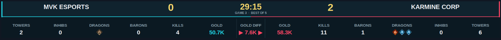

# LoL Esports Scoreboard

A compact, broadcast-style scoreboard for live League of Legends esports games. Choose an in-progress game to view team stats, series score, game clock, and gold difference.



## Getting started

1. Install Python 3 (if you don't have it installed already).
2. Open a terminal in the project folder and create a virtual environment:

   **Windows**
   ```bash
   py -m venv .venv
   .venv\Scripts\activate
   ```

   **macOS or Linux**
   ```bash
   python3 -m venv .venv
   source .venv/bin/activate
   ```

3. Install the dependencies and run the app:

   **Windows**
   ```bash
   python -m pip install -r requirements.txt
   python main.py
   ```

   **macOS or Linux**
   ```bash
   python3 -m pip install -r requirements.txt
   python3 main.py
   ```

4. Choose a game from the picker. If there’s only one in-progress game, its scoreboard opens automatically.

The picker includes a delay slider for game data. The minimum delay is 30 seconds due to API limitations. This is usually still ahead of the live broadcast, which is often delayed by around 60 seconds.

On some Linux systems, Tkinter may need to be installed separately through your package manager.